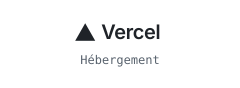
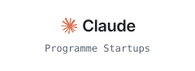
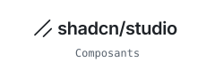

<picture><source media="(prefers-color-scheme: dark)" srcset="https://shieldcn.dev/views/user/TeeBo8.svg?base=404&variant=outline&font=geist"/></picture>

Développeur full-stack à Bordeaux, freelance sous le nom de TeeboStudio.

Portfolio : [teebostudio.fr](https://teebostudio.fr)

## Projets

### Produits

- **[BeeDirectory](https://bee-directory.com)** — Annuaire de newsletters pour trouver où sponsoriser. Clients payants.

### Clients

- **[Les Clefs du Crédit](https://www.lesclefsducredit.fr)** — Site d’un courtier en prêt immobilier : simulateur, blog, référencement local.
- **[Cabinet Delcros](https://cabinetdelcros.com)** — Site d’un courtier bordelais, avec cinq simulateurs de prêt testés.

### Code ouvert

- **[NeuroBlend](https://github.com/TeeBo8/NeuroBlend-Marketplace)** — Place de marché multi-vendeurs : trois rôles, paiements répartis par Stripe Connect ([démo](https://neuroblend-demo.teebostudio.fr)).
- **[Astro Blaster](https://github.com/TeeBo8/astro-blaster)** — Shoot'em up néon en Python : graphismes, sons et musique générés par le code, boss en trois phases.
- **[Neon Maze](https://github.com/TeeBo8/neon-maze)** — Labyrinthe 3D façon Wolfenstein rendu dans le terminal en couleurs 24 bits : du C99 en un seul fichier, sans aucune dépendance.

[teebostudio.fr](https://teebostudio.fr) est construit avec :

<table>
  <tr>
    <td><a href="https://vercel.com"><picture><source media="(prefers-color-scheme: dark)" srcset="assets/logos/vercel-dark.svg"/></picture></a></td>
    <td><a href="https://claude.com"><picture><source media="(prefers-color-scheme: dark)" srcset="assets/logos/claude-dark.svg"/></picture></a></td>
  </tr>
  <tr>
    <td><a href="https://shadcnstudio.com"><picture><source media="(prefers-color-scheme: dark)" srcset="assets/logos/shadcnstudio-dark.svg"/></picture></a></td>
    <td><a href="https://chanhdai.com"><picture><source media="(prefers-color-scheme: dark)" srcset="assets/logos/chanhdai-dark.svg"/></picture></a></td>
  </tr>
</table>
